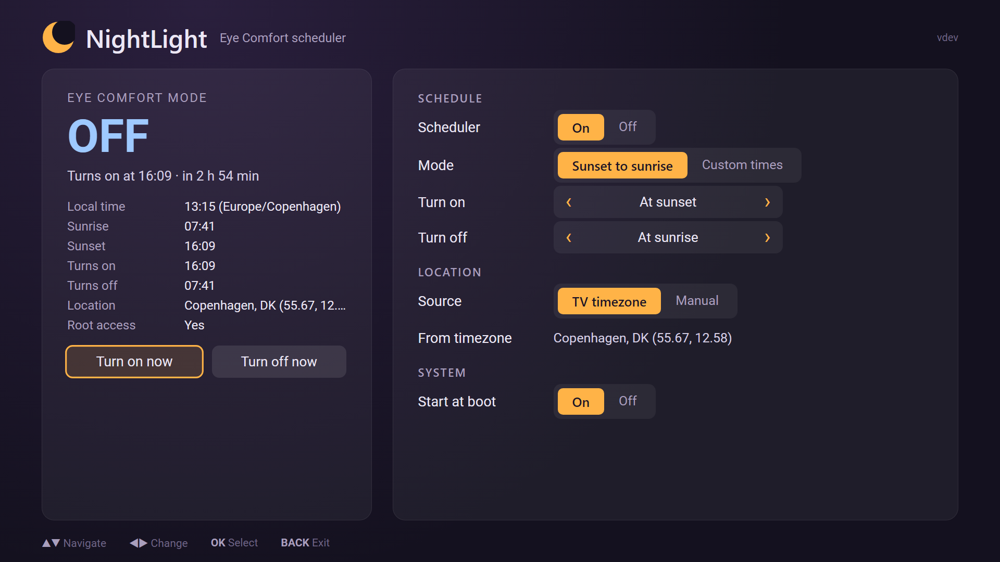

# NightLight for webOS

NightLight is a homebrew app for rooted LG TVs that turns Eye Comfort Mode (LG's blue light filter) on in the
evening and off in the morning. It can follow sunset and sunrise, optionally shifted by a number of minutes, or use
fixed on and off times.

Sunrise and sunset are determined from the TV's timezone setting. Since a timezone can cover a large area, you can
switch Location to Manual in the app and enter your latitude and longitude for better accuracy.



## Requirements

- A rooted LG webOS TV with [Homebrew Channel](https://github.com/webosbrew/webos-homebrew-channel) installed. Root
  lets the scheduler start by itself when the TV boots.
- Tested on webOS 10.3.1.

## Installing

Download the latest `.ipk` file from the [Releases](https://github.com/evilbananas/nightlight-webos/releases) page,
then install it using one of the methods below.

### Device Manager app

1. Install [webOS Dev Manager](https://github.com/webosbrew/dev-manager-desktop) on your computer and add your TV.
2. Open the **Apps** tab, click **Install**, and select the downloaded `.ipk` file.

### webOS TV CLI tools

1. Install the [webOS TV CLI](https://webostv.developer.lge.com/develop/tools/cli-installation) and register your TV
   with `ares-setup-device`.
2. Install the package:

   ```sh
   ares-install org.nightlightwebos.app_<version>_all.ipk
   ```

### After installing

Open NightLight once on the TV. That one-time launch sets things up so the schedule keeps running after a reboot
without opening the app again.

## Troubleshooting

If the app says it could not change Eye Comfort Mode, your TV model may not have that setting. You can check over
SSH:

```sh
luna-send -n 1 luna://com.webos.settingsservice/getSystemSettings '{"category":"picture","keys":["eyeComfortMode"]}'
```

Logs can be viewed over SSH with `journalctl | grep nightlight`, or in `/var/log/messages` on older firmware.
