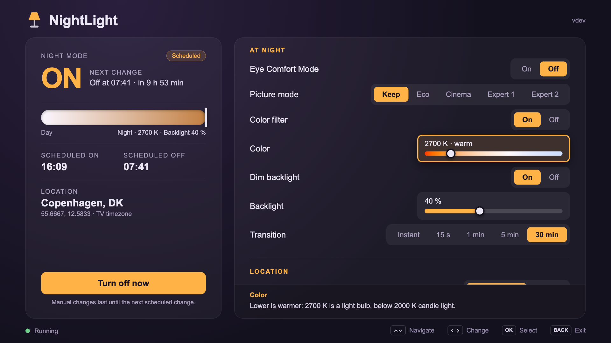

# NightLight for webOS

NightLight is a homebrew app for rooted LG TVs that turns Eye Comfort Mode (LG's blue light filter) on in the
evening and off in the morning. It can follow sunset and sunrise, optionally shifted by a number of minutes, or use
fixed on and off times.

Sunrise and sunset are determined from the TV's timezone setting. Since a timezone can cover a large area, you can
switch Location to Manual in the app and enter your latitude and longitude for better accuracy. The app shows the name
of the nearest town next to them. It looks this up on the TV in a list of places from [GeoNames](https://www.geonames.org/)
(CC BY 4.0), so the coordinates aren't sent anywhere.



## At night

Besides Eye Comfort Mode, NightLight can change these picture settings at night. Each one can be turned on or off
under **At night**:

- **Picture mode** switches to another picture mode at night and back to yours in the morning. See below for
  when you need it.
- **Color filter** shifts the picture toward a color temperature from 1000 K (deep red) over 2700 K (warm light
  bulb) to 10000 K (cool blue). It sets the TV's Color Temperature slider and its white balance.
- **Dim backlight** lowers the backlight to the level you pick. On LCD TVs this does the most against a picture
  that's too bright at night.
- **Transition** fades to the night picture and back over up to 3 hours, instead of switching at once.
- **Notifications** (under System) show a message on the TV when night mode turns on or off.

Your own picture settings are saved before the first change in the evening and put back in the morning, also when
the TV was off or restarted in between. The TV keeps separate settings for each input, picture mode and SDR/HDR, so
when one of these changes at night (for example when HDR content starts), the night picture is applied there too.

### Why switch the picture mode at night

How warm the color filter can get depends on the picture mode. On a webOS 4.4 LCD TV, tested by eye:

| Picture mode    | Color Temperature slider | White balance        |
|-----------------|--------------------------|----------------------|
| Vivid, Standard | works                    | ignored              |
| Expert          | works                    | works, down to red   |

The slider alone stops at LG's warmest setting (W50), which is warmer but still far from candle light. Below about
4000 K, only the white balance makes the picture warmer, and Vivid and Standard ignore it. So if you watch in Vivid
or Standard and want a really warm picture at night, set **Picture mode** to **Expert 1** or **Expert 2**. NightLight
then switches to it in the evening, fades the colors and backlight there, and switches back to your picture mode
after the morning fade.

- **Expert 1** and **Expert 2** are LG's calibrated modes (for bright and dark rooms). They allow the full color
  range and are a good choice at night. Expert 2 is meant for dark rooms.
- **Cinema** is warmer and darker than Vivid by default. Whether the white balance works there wasn't tested.
- **Eco** lowers the brightness to save power. Whether the white balance works there wasn't tested either.
- **Keep** never changes the picture mode.

Switching picture modes happens at once, since there's nothing to fade between. Only SDR content is switched. HDR
uses its own picture modes, so HDR content keeps its mode and just gets the color filter and dimming. If you change
the picture mode yourself at night, NightLight leaves it as you set it until the morning.

The Kelvin values are approximate. LG doesn't document what the slider and white balance values stand for, so
NightLight's mapping was calibrated by eye on one TV and can look a bit different on yours.

## Requirements

- A rooted LG webOS TV with [Homebrew Channel](https://github.com/webosbrew/webos-homebrew-channel) installed. Root
  lets the scheduler start by itself when the TV boots.
- Tested on webOS 10.3.1. The night picture features were tested on webOS 4.4.3 (LG 55UK7550LLA from 2018,
  firmware 05.50.70).

## Installing

### Homebrew Channel

1. In Homebrew Channel, open **Settings** and add this URL as an extra repository:

   ```text
   https://raw.githubusercontent.com/evilbananas/nightlight-webos/gh-pages/repo.json
   ```

2. Go back to the app list, select **NightLight**, and install it. Updates show up there too.

### Manual install

Download the latest `.ipk` file from the [Releases](https://github.com/evilbananas/nightlight-webos/releases) page,
then install it using one of the methods below.

#### Device Manager app

1. Install [webOS Dev Manager](https://github.com/webosbrew/dev-manager-desktop) on your computer and add your TV.
2. Open the **Apps** tab, click **Install**, and select the downloaded `.ipk` file.

#### webOS TV CLI tools

1. Install the [webOS TV CLI](https://webostv.developer.lge.com/develop/tools/cli-installation) and register your TV
   with `ares-setup-device`.
2. Install the package:

   ```sh
   ares-install org.nightlightwebos.app_<version>_all.ipk
   ```

### After installing

Open NightLight once on the TV. That launch sets things up so the schedule keeps running after a reboot without
opening the app again.

Updating NightLight removes its root access and stops the scheduler. Open the app once after each update to start it
again. If you don't, it starts again the next time the TV boots.

## Troubleshooting

If the app says it could not change Eye Comfort Mode, your TV model may not have that setting. You can check over
SSH:

```sh
luna-send -n 1 luna://com.webos.settingsservice/getSystemSettings '{"category":"picture","keys":["eyeComfortMode"]}'
```

If the color filter or dimming has no effect, check that your TV has the settings NightLight uses:

```sh
luna-send -n 1 luna://com.webos.settingsservice/getSystemSettings '{"category":"picture","keys":["pictureMode","backlight","colorTemperature","whiteBalanceRedGain","whiteBalanceGreenGain","whiteBalanceBlueGain"]}'
```

When run over SSH, `luna-send` may print nothing unless the session has a terminal (`ssh -t`).

If the color filter only gets a little warmer, your picture mode probably ignores the white balance. Set **Picture
mode** under **At night** to **Expert 1** or **Expert 2** (see [Why switch the picture mode at
night](#why-switch-the-picture-mode-at-night)). On some TVs, Eye Comfort Mode also locks the color temperature. If
colors don't change at all, turn Eye Comfort Mode off under **At night**.

Logs can be viewed over SSH with `journalctl | grep nightlight`, or in `/var/log/messages` on older firmware.
